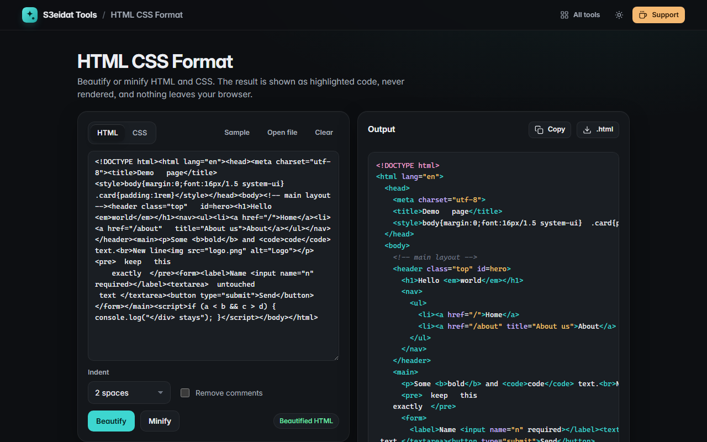

# HTML CSS Format

> Beautify or minify HTML and CSS. Free, private, and it runs entirely in your browser.

### ▶ [Open HTML CSS Format](https://s3eidat.github.io/html-css-format/)



## Features

- **HTML beautifier** with its own tokenizer: one block element per line, inline elements (`<b>`, `<a>`, `<code>`, …) kept in the flow of text
- `<pre>`, `<textarea>`, `<script>` and `<style>` contents are kept **exactly** as written
- Knows **void elements** (``, `<br>`, `<input>`, `<meta>`, …) and implied end tags (`<li>`, `<p>`, `<td>`, `<option>`); it never invents closing tags you didn't write
- Attribute whitespace tidied, attribute values untouched
- **HTML minifier**: collapses whitespace, drops whitespace between block-level tags, keeps the single space between inline elements, optionally removes comments (IE conditional comments are kept)
- **CSS beautifier**: one declaration per line, selector lists split, `@media` blocks indented, comments kept with their rule
- **CSS minifier**: strings, `url(…)`, `calc()` spacing and `/*! license */` comments are preserved; `a :hover` stays different from `a:hover`
- Indent with 2 spaces, 4 spaces or tabs; bytes before and after and the percentage saved
- The output is **highlighted text and is never rendered** as a live page
- Open or drop a file, copy, or download the result

Like every formatter, beautifying adds whitespace between block-level tags; that is invisible in normal pages but can matter for
elements styled as `inline-block`.

## Privacy

Your code never leaves your device. There is no server, no account, no analytics.
The page ships with a strict Content-Security-Policy (`connect-src 'self'`), so the browser
itself blocks any attempt to send data anywhere.

## Run it yourself

It's plain HTML, CSS and JavaScript with no build step:

```bash
git clone https://github.com/s3eidat/html-css-format
cd html-css-format
python -m http.server 8000
```

Then open http://localhost:8000.

## Support

If this saved you time, **[buy me a coffee ☕](https://s3eidat.github.io/coffee/)**. It keeps every tool free.

---

Part of **[S3eidat Tools](https://s3eidat.github.io/)**: 100+ free, private tools that run in your browser. MIT licensed.
